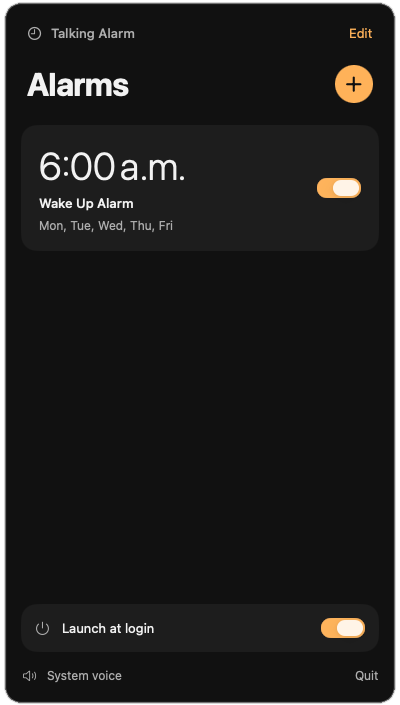
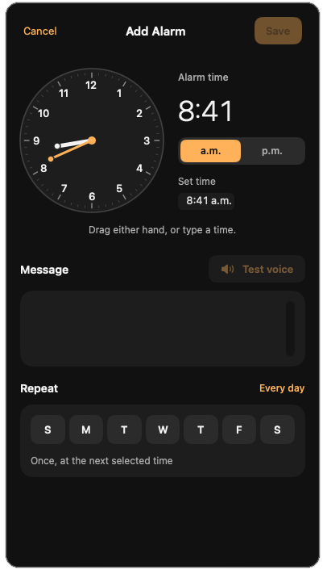

# Talking Alarm

A small native macOS menu bar app that speaks your custom alarm messages using the same system voice as Terminal's `say` command.

## Screenshots

These screenshots, provided by the project owner, show the alarm list and alarm editor.

| Alarm list | Add an alarm |
| --- | --- |
|  |  |

## Features

- Set one-time alarms or repeat them every day or on selected weekdays.
- Drag either clock hand, type a time directly, or switch AM/PM.
- Enter exactly what the alarm should say and preview it with **Test voice**.
- Swipe the whole alarm card to reveal Delete, or right-click for actions.
- Save alarms locally, launch at login, and show a centered alert when an alarm fires.

## Requirements

- macOS 13 or newer.
- Swift 6 or newer, provided by Xcode or the Xcode Command Line Tools.

## Build and install

```sh
git clone https://github.com/alesloa/talking-alarm-macos.git
cd talking-alarm-macos
zsh scripts/build-app.sh
```

Move `dist/Talking Alarm.app` into Applications and open it. Click the clock icon in the menu bar to add an alarm.

The app enables launch at login on its first launch from Applications. You can change this using **Launch at login** in the panel. macOS may require approval in System Settings → General → Login Items.

For a temporary run from the build folder:

```sh
open "dist/Talking Alarm.app"
```

## Use

Click the clock in the menu bar, add an alarm, enter the exact message to speak, and choose repeat days. Drag the short clock hand to adjust hours or the long hand to adjust minutes; dragging across twelve carries the time forward or backward. The digital readout, editable Set time field, and AM/PM controls all stay in sync. No days means a one-time alarm. Use Test voice to hear your exact message. Drag the alarm card left, or use a horizontal trackpad swipe, to reveal a separate Delete panel on its right; drag/swipe right to close it. The whole card, including its enable switch, moves together. The switch stays visible and usable while Delete is open. Swiping only reveals the action: click Delete to remove the alarm. Right-click for Edit Alarm, Enable/Disable Alarm, and Delete Alarm. Alarms are saved in `~/Library/Application Support/TalkingAlarm/alarms.json`.

The app must be running and the Mac awake for an alarm to fire. It does not wake the Mac or replay missed alarms. Speech plays once through the current system audio output; a centered window stays until dismissed. Closing that window does not stop speech. There is no snooze.

## UI provenance

Alarm times, messages, enabled state, and repeat days come from the user's input and the saved alarms file. Day names and formatted times come from Foundation's current calendar and locale. Speech comes from /usr/bin/say with no voice override, using the same default voice as Terminal's say command. Messages are passed as literal arguments without a shell; speech requests play in order. Error text comes directly from the caught system error's localizedDescription or say's stderr. Login state comes from SMAppService. Control labels describe the implemented app actions and the owner's requested alarm workflow; there are no sample alarms or invented support identifiers. See DESIGN.md for the native redesign audit and visible-value sources.

## Verify

```sh
swift test
TALKING_ALARM_RENDER_DIR="$PWD/artifacts" swift test --filter InterfaceRenderTests
```

The render command captures real SwiftUI screens without changing saved alarms or starting a scheduler.
